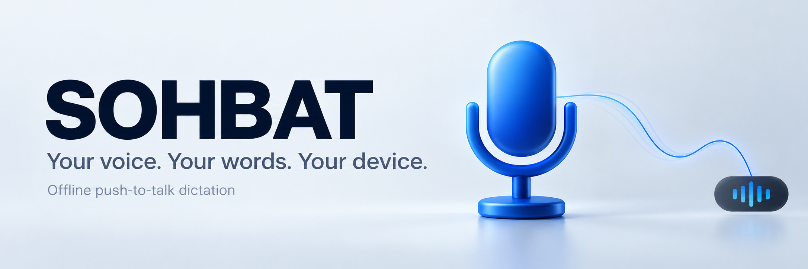
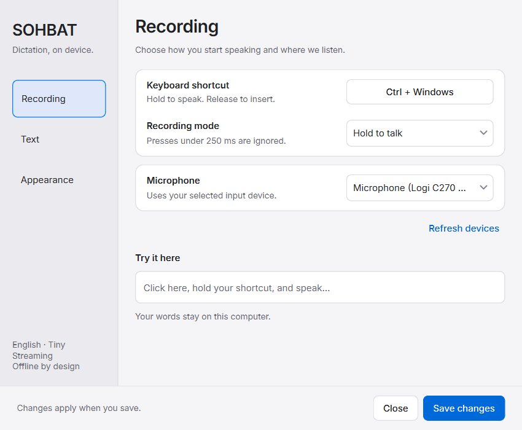



# SOHBAT

**Local push-to-talk dictation for Windows.** Hold **Ctrl + Windows**, speak, then release both keys to insert your words into the focused text field.

SOHBAT runs Moonshine Tiny Streaming on your computer. After the initial dependency and model download, normal dictation works offline. No account, cloud transcription, or API key is required.

> Early development build. English only. Windows 11 has been tested. There are no downloadable releases yet; run from source using the instructions below.

## What it does

- Global hold-to-talk or toggle shortcut, configurable without restarting.
- A click-through translucent recording capsule with live microphone levels and streaming partial text.
- Interruptible island-style expansion, reduced-motion and reduced-transparency options.
- Clipboard paste with clipboard restoration, plus a simulated-typing option.
- Browser and Electron editor compatibility, with focused-window checks.
- Offline cleanup of whitespace, capitalization, punctuation, and optional filler removal.
- Compact Inter settings, light/dark themes, microphone selection, a test field, and optional Windows startup.
- One model loaded at startup and kept warm between recordings.



## Run from source

Requirements: **64-bit Windows**, Python **3.10–3.14**, a microphone, and an internet connection for first-time setup. Development was verified with Python 3.14.3 on Windows 11.

```powershell
git clone https://github.com/mathofdynamic/SOHBAT.git
cd SOHBAT
./scripts/setup.ps1
./run.ps1
```

Setup creates `.venv`, installs the project and development checks, then downloads the English Tiny Streaming model. If PowerShell blocks local scripts, use a process-scoped policy for the current terminal:

```powershell
Set-ExecutionPolicy -Scope Process Bypass
```

For a console launch:

```powershell
.venv/Scripts/python -m sohbat
```

The app lives in the system tray. **Settings** opens preferences; **Pause** suspends the shortcut; **Quit** shuts down the worker and microphone.

### Using the shortcut

1. Click the text field you want to write into.
2. Hold **Ctrl + Windows** and speak.
3. Release **both keys**. SOHBAT finalizes the text and pastes it.

Presses under 250 ms are ignored. Silence alone does not end a recording. Toggle mode starts and stops on separate shortcut presses; each press must last at least 250 ms. Dictation is capped at five minutes.

If focus changes during dictation, insertion is canceled. Browser compatibility permits a focused Chromium/Electron editor host when Windows accessibility cannot identify its text caret. Some applications still need manual validation. Windows can block input into elevated applications.

## First-time model download

```powershell
./scripts/download-model.ps1
```

The downloader requests **English, `ModelArch.TINY_STREAMING`, architecture 2** and records its local path. SOHBAT never calls the downloader during normal startup.

For a manual download, use the eight files listed in [the model guide](docs/MODELS.md). Place them together under `models/tiny-streaming-en`, then run the path-configuration command in that guide. Model weights are excluded from this repository.

Small Streaming and Medium Streaming use architecture numbers **4** and **5**. Swapping currently requires changing the downloader and engine constructor together, downloading the corresponding model, and restarting. The settings window does not offer model switching. Other languages, including Persian, are not supported in this version.

## Local installation and updates

The repository includes an optional local packaging and installation workflow:

```powershell
./scripts/install.ps1
```

It builds a PyInstaller directory distribution, updates `%LOCALAPPDATA%/Programs/SOHBAT`, creates a Start Menu shortcut, preserves preferences, and restarts the same app. It does **not** publish a GitHub release.

Preferences and rotating diagnostic logs live under `%LOCALAPPDATA%/SOHBAT`. Existing installations under the former Flowlet name migrate their settings and managed model files automatically. The old startup entry and shortcut are replaced. Legacy files are retained to avoid deleting user data.

Enable **Open at sign-in** in Settings → Text to start with Windows.

## Verification

```powershell
./scripts/check.ps1
```

This runs Ruff, mypy, and pytest. Tests cover text cleanup, hold/toggle gestures, real model streaming against three synthetic English fixtures, preferences keyboard/save behavior, and spring continuity. The engine test is skipped if the optional local model fixture directory is absent.

```powershell
.venv/Scripts/python scripts/benchmark.py
.venv/Scripts/python scripts/capture_ui.py
.venv/Scripts/python scripts/smoke_injection.py
```

The native capture script renders settings, overlay states, focus indicators and animation frames, and records transparency, timing and focus evidence under ignored `.perfection/` output. The injection smoke needs Windows to grant its test window foreground focus.

### Measurements from development

These are measurements on one Windows 11 machine, not performance guarantees:

| Check | Observed |
|---|---:|
| Cached Tiny Streaming model load | 223 ms |
| First partial transcript | After 0.6 s of fixture audio |
| Finalization, three 3.0–3.9 s synthetic clips | 6.95–7.95 ms |
| Fixture recognition | One substitution across 26 reference words |
| Full installed app resident memory | Approximately 249 MB |
| Settled idle CPU | 0.0% in the sampled interval |
| Success state to hidden overlay | Approximately 343 ms |

Finalization time is **not** release-to-paste latency. Cold process-to-ready time and end-to-end latency for a five-second utterance remain unmeasured. See [MANUAL_TESTS.md](MANUAL_TESTS.md) for physical-hardware and application checks.

## Current limitations

- English-only Moonshine engine; no multilingual or Whisper engine yet.
- Editable-focus detection varies by application. Elevated targets and some custom editors can reject paste.
- Microphone unplug/reconnect recovery, five-minute cap/toggle synchronization, and fallback resampling need broader real-world testing.
- A model-load failure currently requires correcting the model path and relaunching.
- Clipboard restoration can fail if another process owns the clipboard; failures are logged.
- Screen-reader announcements and 200% text scaling have not been fully validated.
- The recording surface uses alpha translucency, rather than native Windows acrylic blur.

## Project structure

```text
sohbat/
  engine/          SpeechEngine interface and Moonshine streaming adapter
  audio.py         Microphone capture, bounded buffer, levels, resampling
  hotkey.py        Global shortcut and gesture state
  inject.py        Focus checks, clipboard paste, typing
  accessibility.py Windows UI Automation focus inspection
  ui/              Preferences, tray, island, bundled typography
  config.py        Per-user JSON settings and legacy migration
  main.py          Worker, Qt signals, lifecycle and single-instance lock
scripts/           Setup, model download, checks, captures and local packaging
tests/             Unit/integration checks and synthetic WAV fixtures
docs/              Model instructions, branding and README assets
```

## Credits and license

SOHBAT source is licensed under [MIT](LICENSE). Speech recognition uses [Moonshine Voice](https://github.com/moonshine-ai/moonshine). Inter is bundled under its [SIL Open Font License](sohbat/assets/fonts/OFL.txt).

The microphone logo and banner were created with image generation for this project. See [branding notes](docs/BRANDING.md). Model weights and third-party dependencies retain their own licenses.
